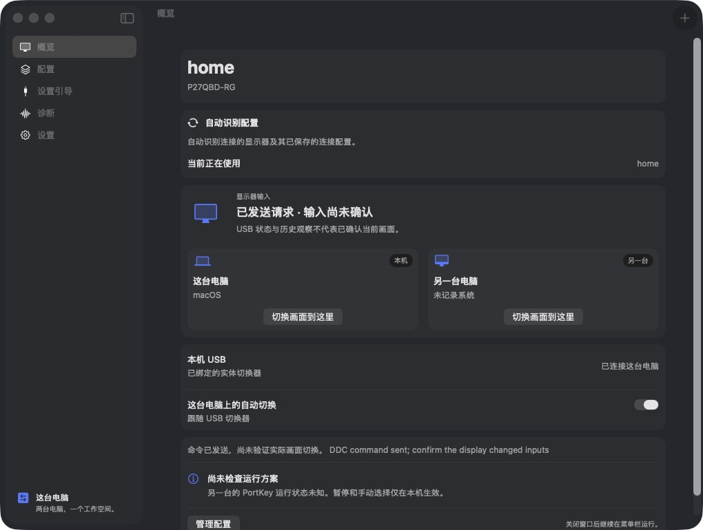
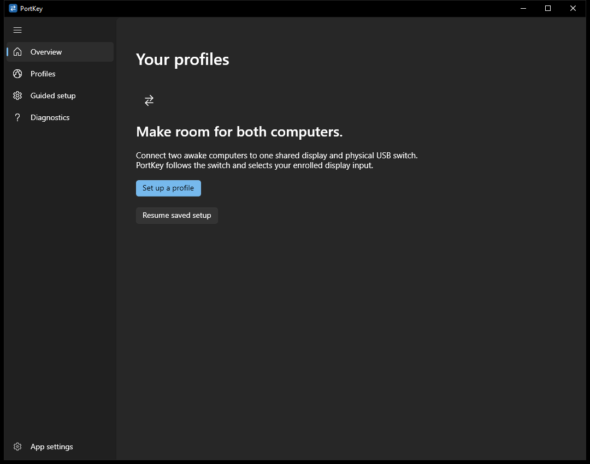

# PortKey

**Switch your USB. Let your display follow.**

PortKey follows a physical USB switch and selects the matching input on your shared monitor. A shared Rust core powers native **SwiftUI/AppKit on macOS** and **WinUI 3 on Windows**. No account, server, or keyboard/mouse tracking.


## Native on both platforms

| macOS | Windows |
| --- | --- |
|  |  |

Actual application captures: a configured Mac and an isolated Windows first-run session. Both apps stay in the menu bar or system tray when the window closes. English and Simplified Chinese are available.

- **Home and Work profiles:** automatically recognize an enrolled display when connected.
- **Different cables, same monitor:** save multiple wiring profiles and choose **Use this profile**. PortKey remembers your choice; it cannot infer which HDMI cable you moved.
- **One or two installations:** use one controller when it can switch both directions; otherwise run PortKey on both computers with matching input mappings.
- **Guided setup:** name the computers, enroll the monitor and USB switch, and verify the intended inputs. New configurations start with automation off.

## What you need

Two awake computers, each connected by video to the same DDC/CI-capable monitor, plus a physical two-host USB switch. Enable DDC/CI in the monitor’s own menu. Compatibility depends on the monitor, cables, GPU and USB topology.


The diagram is one example. Mac/Mac and Windows/Windows configurations are also supported by the setup model. Some monitors reject commands from an inactive video input, which can require PortKey on both computers. Each app acts locally: pausing one does not pause the other, and selecting a display input does not move the physical USB switch. Keep the monitor’s input menu and USB selector available for recovery.

## Download

Download **[PortKey v1.0.0](https://github.com/jukrb0x/portkey/releases/tag/v1.0.0)** for macOS arm64 or Windows x64. Builds have been tested locally on Apple Silicon macOS and Windows 11 x64. This is not universal hardware compatibility or a completed sleep/wake qualification. See the [verification record](docs/RUST-VERIFICATION.md) for the measured scope.

The Mac package is ad-hoc signed, without Apple Developer ID notarization. The Windows package is unsigned and needs the matching Windows App SDK runtime. Public signing and clean-machine installation remain release review items.

## Build

macOS: Apple Silicon, macOS 13+, stable Rust and Apple Command Line Tools.

```sh
./scripts/test.sh
./scripts/build-app.sh
open dist/PortKey.app
```

Windows x64: stable Rust/MSVC, Visual Studio C++ desktop tools and Windows SDK 10.0.26100. See [Windows build/runtime prerequisites](native/windows/README.md).

```powershell
cargo test --locked
./scripts/build-windows.ps1
./dist/PortKey-Windows/PortKey.exe
```

Keep the entire Windows package together. Its included `Install-WindowsRuntime.ps1` installs the pinned Microsoft runtime as an explicit action. Neither app installs a background service or login item.

## Development

```sh
cargo fmt --check
cargo clippy --locked --all-targets -- -D warnings
./scripts/test-rust.sh
```

CI checks the Rust core and both native builds. The [release workflow](.github/workflows/release.yml) builds and publishes versioned archives and checksums after both platform checks pass. See the [release notes](docs/releases/v1.0.0.md).

Configuration stays in `~/Library/Application Support/PortKey/` on macOS or `%APPDATA%\PortKey\` on Windows. Quit before backing up or restoring it. Use a fresh `PORTKEY_CONFIG_DIR` for isolated development; do not copy enabled live profiles into smoke tests.

The previous Swift controller is retired. Configure this version through the current setup guide; configurations from earlier Swift/Rust previews are not migrated. See the [implementation brief](docs/IMPLEMENTATION-BRIEF.md) and [m1ddc provenance/license](ThirdParty/m1ddc/UPSTREAM.md).
