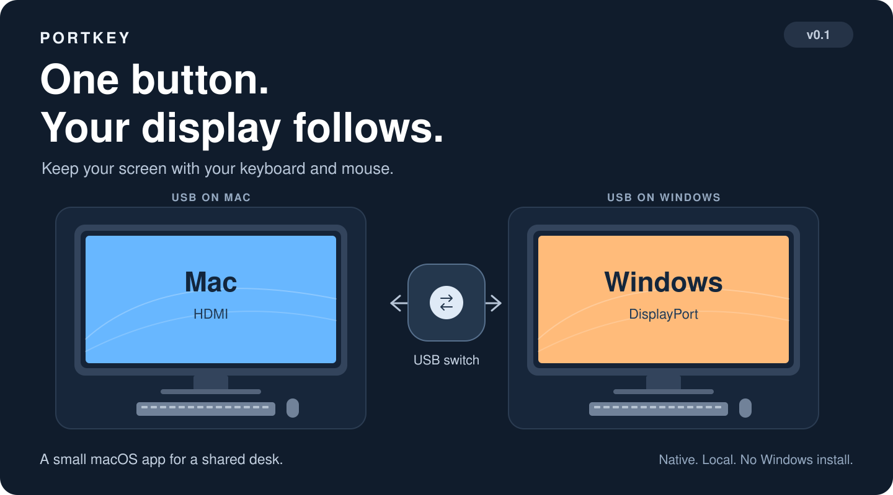
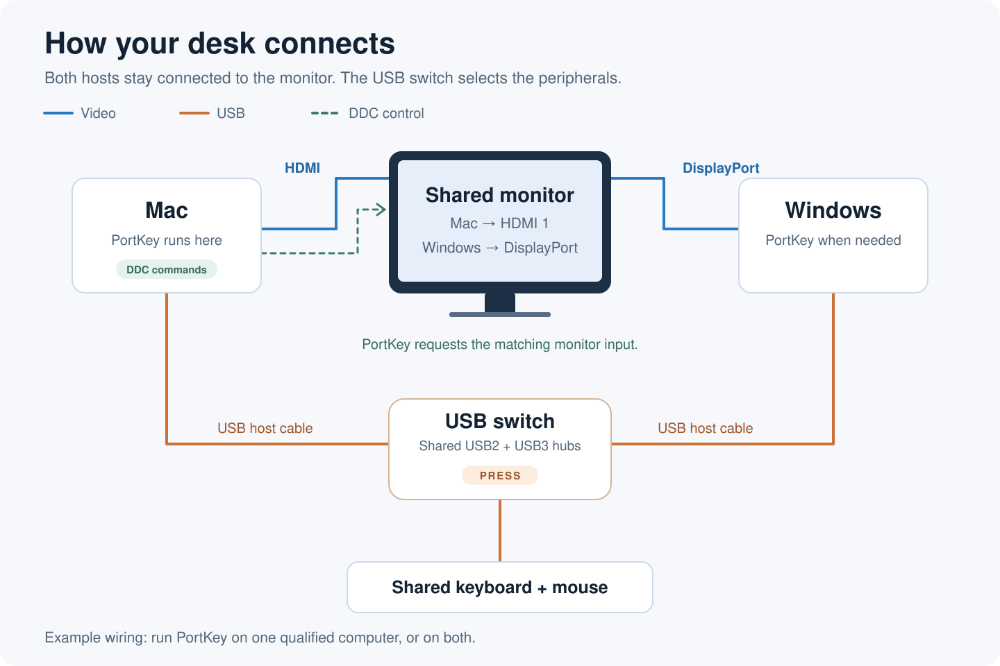

# Portkey

**Switch your USB. Let your display follow.**



One monitor, two computers, one keyboard and mouse. Portkey connects the missing piece: press your USB switch, and the monitor follows your peripherals to the right computer. No reaching behind the display or navigating its input menu.

Portkey lives in the macOS menu bar and uses DDC to select the monitor input. Everything runs on the Mac; Windows needs no software.

- **Follow the shared hubs.** Detects the enrolled USB2/USB3 pair, so unplugging a keyboard alone leaves the display where it is.
- **Take control when you need it.** Select Mac or Windows from the menu, or pause automatic switching.
- **Use either language.** Switch between English and Simplified Chinese instantly, with your preference saved.

## Version 0.1

This first version is built and tested for a specific desk setup: an Apple Silicon Mac connected by HDMI, a Windows PC connected by DisplayPort, a Philips 27M2N5800, and a UGREEN USB switch with shared USB2/USB3 hubs. Both computers must be awake. The default configuration retains that setup's monitor and hub enrollment; check **Settings / Rebind…** before using it elsewhere.

Broader hardware support and a guided first-run setup are future work. Sleep/wake recovery can take time while macOS and the display become ready. See [Enrollment and recovery](#enrollment-and-recovery) for the current behavior and limits.

## How it connects

Each computer has its own video connection to the shared monitor and a USB connection to the switch. Press the hardware USB switch; Portkey observes the shared hubs on the Mac and requests the matching monitor input. DDC control travels over the Mac's existing HDMI connection.



## Build and run

Requires an Apple Silicon Mac, macOS 13 or later, and Apple Command Line Tools (`xcode-select --install`). There are no third-party Swift dependencies or administrator background services.

```sh
cd ~/dev/portkey
./scripts/test.sh
./scripts/build-app.sh
open 'dist/Portkey.app'
```

The build compiles the pinned m1ddc revision, retains its license, and creates a locally ad-hoc-signed app. This development build is not notarized.

## Menu and language

The menu-bar display icon shows **M** when both Mac hubs are present, **?** when both are absent, **·** for an incomplete or unknown state, and **⏸** when automation is paused. The menu provides USB/input status, automatic switching, manual Mac/Windows selection, settings and re-enrollment, logs, and Quit. Manual selection holds until the next genuine USB ownership transition; it also works while automation is paused. A confirmed DDC readback means the monitor returned the target input value; it does not independently confirm the visible picture.

The UI defaults to English. Choose **English** or **Simplified Chinese** in the language submenu to save your preference. Menu items, the settings window, and current status text change immediately without restarting the app. Controls use the selected language; hardware/backend errors may include original system or helper details.

## Enrollment and recovery

Open **Settings / Rebind…** to inspect the online display UUID, shared USB2/USB3 hub locations, and parent hubs. Identical upstream hubs can coexist, so VID/PID alone cannot identify the shared branches. After moving a Mac port, dock, or cable, switch USB to Mac, explicitly select the new shared branches, and save. Invalid edits leave the saved configuration intact; **Rescan / Revert Edits** restores saved values.

The bundle identifier and application-data directories retain their original names to preserve enrollment and preferences:

- Bundle identifier: `local.usbfollowdisplay.app`
- Configuration: `~/Library/Application Support/USBFollowDisplay/config.json`
- Log: `~/Library/Logs/USBFollowDisplay/app.log` (rotated at approximately 512 KB)

Automatic switching and UI language are saved in the app's local preferences. Logs contain device/control state, without keystrokes, mouse activity, or network information.

If USB is absent at startup, ownership stays unknown and the app does not select Windows. An incomplete hub pair waits; unplugging only the keyboard does not change the input. Sleep cancels pending work. Wake re-enumerates USB and does not replay a stale departure command when USB is absent. A real locked-session trial recovered the external screen without Accessibility permission, but system/display readiness took time: readback confirmation arrived about 23 seconds after wake in that run. Immediate recovery is not guaranteed. Unplugging or powering off the entire USB switch can produce the same signal as selecting Windows.

Writes always target the enrolled display UUID. A request makes at most three attempts, with failure delays of 750 and 1500 ms. Each helper process has a 2.5-second deadline and is terminated and reaped if necessary. This Philips can return 0 for the first few seconds after a write, so the backend waits 4 seconds before reading back; cancellation or reversal interrupts the wait. Zero, malformed output, and values outside the enrolled inputs remain unconfirmed.

For read-only terminal diagnostics, which do not switch inputs:

```sh
'dist/Portkey.app/Contents/MacOS/Portkey' --diagnose
```

Reopening the running app shows settings. **Open Status Menu** in settings opens the same menu. Launch with `--settings` to show settings immediately or `--paused` to start that session with automation paused. Rebuild the app if the helper is missing; open settings and save a valid enrollment if configuration is damaged.

To uninstall, quit and delete the app. You can also remove the configuration/log directories above and the preferences for `local.usbfollowdisplay.app`. The app installs no login item or global helper.

## Tests and evidence

`./scripts/test.sh` runs deterministic Swift policy, scheduling, real-process timeout/output, and configuration checks without DDC writes. The suite uses a SwiftPM executable assertion runner so it also works with Command Line Tools installations that lack XCTest/Swift Testing. Build verification is available through `./scripts/verify-bundle.sh`.

See the [design](docs/design.md) and [implementation record](docs/implementation-plan.md) for architecture and qualified hardware behavior. Machine-specific logs, device inventories, and acceptance transcripts are local-only and excluded from Git. Simulated lifecycle tests do not replace real sleep acceptance.

The backend revision, provenance, and license are documented in [ThirdParty/m1ddc/UPSTREAM.md](ThirdParty/m1ddc/UPSTREAM.md).
